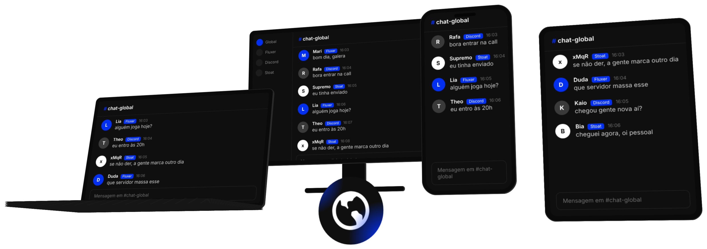
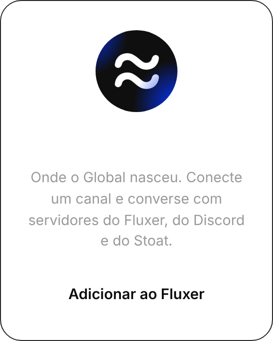
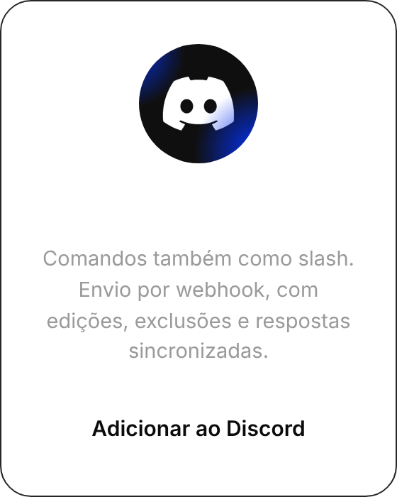
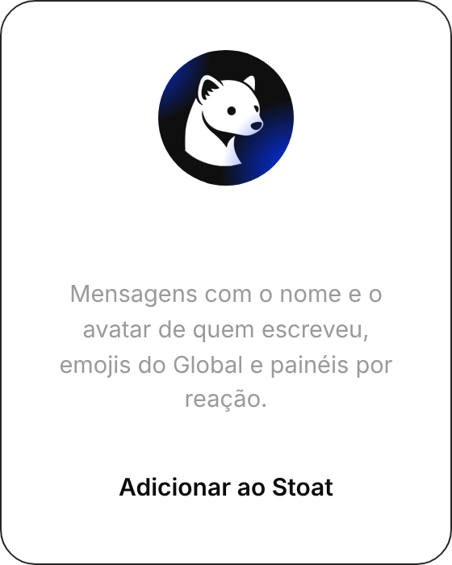

<div align="center">



<br>
<br>

[](https://globalbot.site)
[](https://nodejs.org)
[](https://www.mongodb.com)
[](LICENSE)

</div>

---

<div align="center">

<picture><source media="(prefers-color-scheme: light)" srcset=".github/assets/readme/t-sobre-light.png"></picture>

<br>

O Global junta comunidades do <a href="https://fluxer.app">Fluxer</a>, do Discord e do Stoat num mesmo chat.<br>
Cada servidor escolhe um canal, e o que é escrito ali aparece nos canais dos outros.<br>
Editar, apagar e responder também funciona entre os servidores.

<br>

<sub>Este repositório é o bot. O site fica em <a href="https://github.com/globaloficial/global_site">globaloficial/global_site</a>.</sub>

</div>

---

<div align="center">

<picture><source media="(prefers-color-scheme: light)" srcset=".github/assets/readme/t-funciona-light.png"></picture>

<br>

| Etapa | O que acontece |
| :---: | --- |
| **1** | Alguém escreve no canal global do servidor |
| **2** | A mensagem passa pelos filtros: links, convites, spam, palavras e NSFW |
| **3** | O vínculo é guardado no MongoDB, para sincronizar edições e exclusões |
| **4** | Emojis e menções são convertidos para a plataforma de destino |
| **5** | Cada plataforma tem a sua fila, com limite de requisições |
| **6** | O bot envia com o nome e o avatar de quem escreveu |

<sub>O Global precisa de <b>Gerenciar Webhooks</b> no canal conectado. Sem isso, a mensagem não chega e o bot avisa no canal.</sub>

</div>

---

<div align="center">

<picture><source media="(prefers-color-scheme: light)" srcset=".github/assets/readme/t-pontes-light.png"></picture>

<br>

Quem não quer usar o chat global pode ligar canais de servidores amigos, entre Fluxer, Discord e Stoat.<br>
As mensagens ficam só dentro da ponte.

<br>

| Comando | O que faz |
| --- | --- |
| `g.ponte criar [nome]` | Cria a ponte com o canal atual e gera um código |
| `g.ponte entrar <código>` | Liga o canal atual a uma ponte |
| `g.ponte listar` | Mostra as pontes do servidor |
| `g.ponte sair` | Tira o canal atual da ponte |
| `g.ponte remover <código> <id>` | O dono tira outro servidor da ponte |
| `g.ponte encerrar <código>` | O dono apaga a ponte |

<sub>Até 10 servidores por ponte. Um canal não pode estar no chat global e em uma ponte ao mesmo tempo.</sub>

</div>

---

<div align="center">

<picture><source media="(prefers-color-scheme: light)" srcset=".github/assets/readme/t-comandos-light.png"></picture>

<br>

No Discord os comandos também existem como slash. É preciso ter a permissão <b>Gerenciar Canais</b>.

<br>

| Comando | O que faz |
| --- | --- |
| `g.conectar` · `g.desconectar` | Define ou remove o canal do chat global |
| `g.pausar` · `g.retomar` | Pausa e retoma a conexão |
| `g.config` | Mostra o estado da conexão, do webhook e dos filtros |
| `g.automod` | Ajusta os filtros automáticos |
| `g.ponte` | Cria e gerencia pontes privadas |
| `g.perfil` · `g.destacar` | Perfil do usuário e destaque de mensagens |
| `g.report` | Envia uma mensagem para a moderação |
| `g.botinfo` · `g.ping` · `g.ajuda` | Informações, latência e lista de comandos |

</div>

---

<div align="center">

<picture><source media="(prefers-color-scheme: light)" srcset=".github/assets/readme/t-instalacao-light.png"></picture>

<br>

Requer Node.js 20+ ou Bun, um MongoDB em execução e o token de um bot do Fluxer.

</div>

```sh
git clone https://github.com/globaloficial/global
cd global
bun install
cp .env.example .env
```

<div align="center">

| Variável | Obrigatória | Padrão |
| --- | :---: | --- |
| `TOKEN` | Sim | nenhum |
| `MONGODB_URI` | Não | `mongodb://127.0.0.1:27017/global` |
| `DISCORD_TOKEN` | Não | vazio, e a ponte com o Discord fica desligada |
| `STOAT_TOKEN` | Não | vazio, e a ponte com o Stoat fica desligada |
| `NSFW_URL` | Não | `http://localhost:3000` |
| `NSFW_API_KEY` | Não | vazio |
| `ENTREGA_CONCORRENCIA` | Não | `10` |
| `ENTREGA_REQS_POR_SEGUNDO` | Não | `35` |
| `DISCORD_CONCORRENCIA` | Não | `10` |
| `DISCORD_REQS_POR_SEGUNDO` | Não | `30` |

</div>

> Se o serviço NSFW estiver fora do ar, as mídias são bloqueadas. Ajuste o `NSFW_URL` ou deixe o serviço rodando.

Para o Discord, ative a **Message Content Intent** no [Developer Portal](https://discord.com/developers/applications). O bot também precisa de **Gerenciar Webhooks** e **Gerenciar Mensagens** nos canais conectados.

Para o Stoat, crie um bot nas configurações da sua conta e coloque o token em `STOAT_TOKEN`. O bot precisa das permissões de enviar mensagens, inserir embeds, enviar arquivos, reagir, gerenciar mensagens e **Masquerade** nos canais conectados.

---

<div align="center">

<picture><source media="(prefers-color-scheme: light)" srcset=".github/assets/readme/t-execucao-light.png"></picture>

</div>

```sh
bun index.js
```

Com Node.js, passe o arquivo de ambiente explicitamente:

```sh
node --env-file=.env index.js
```

---

<div align="center">

<picture><source media="(prefers-color-scheme: light)" srcset=".github/assets/readme/t-desenvolvimento-light.png"></picture>

</div>

```sh
bun run lint
bun run typecheck
bun run test
```

---

<div align="center">

<picture><source media="(prefers-color-scheme: light)" srcset=".github/assets/readme/t-estrutura-light.png"></picture>

</div>

```
global/
├── index.js
├── migrations/
├── listas/
├── src/
│   ├── commands/        conexao, geral, staff e dono
│   ├── events/          eventos do Fluxer
│   ├── plataformas/     adaptadores do Fluxer, do Discord e do Stoat
│   ├── services/        filtros, retransmissão, sincronização, pontes e entrega
│   ├── models/          Guild, MensagemGlobal, Ponte e outros
│   ├── handlers/        carregamento e execução de comandos
│   └── util/
└── test/
```

---

<div align="center">

<picture><source media="(prefers-color-scheme: light)" srcset=".github/assets/readme/t-adicionar-light.png"></picture>

<br>

<a href="https://web.fluxer.app/oauth2/authorize?client_id=1562253521942745089&scope=bot&permissions=4503600164629568"><picture><source media="(prefers-color-scheme: light)" srcset=".github/assets/readme/c-fluxer-light.png"></picture></a>&nbsp;&nbsp;
<a href="https://discord.com/oauth2/authorize?client_id=1570965038087413971&permissions=2252764571102209&integration_type=0&scope=applications.commands+bot"><picture><source media="(prefers-color-scheme: light)" srcset=".github/assets/readme/c-discord-light.png"></picture></a>&nbsp;&nbsp;
<a href="https://stoat.chat/bot/01M7ZPBRQA2YZXZMYHFF1D65P6"><picture><source media="(prefers-color-scheme: light)" srcset=".github/assets/readme/c-stoat-light.png"></picture></a>

</div>

---

<div align="center">

<picture><source media="(prefers-color-scheme: light)" srcset=".github/assets/readme/t-licenca-light.png"></picture>

<br>

A política de privacidade está em <a href="PRIVACIDADE.md">PRIVACIDADE.md</a>.<br>
Distribuído sob a <a href="LICENSE">PolyForm Noncommercial 1.0.0</a>.

<br>

[](https://github.com/xMqRs)
[](https://github.com/xMqRs)

</div>
